# An Open Source Incremental Linear Encoder

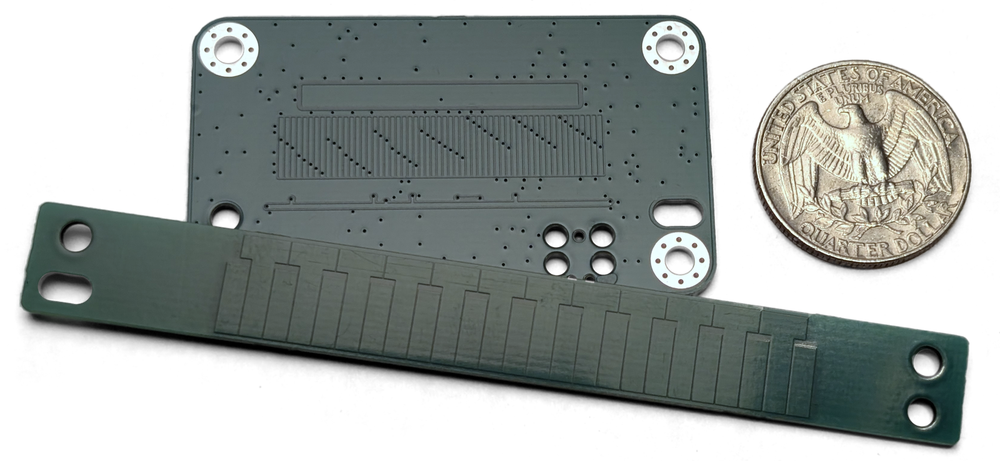

# Overview

An open-source capacitive encoder design with hardware, firmware, test data, and design details.

| Parameter    | Value            |
| ------------ | ---------------- |
| Encoder Type | Incremental      |
| Method       | Capacitive       |
| Accuracy     | 40µm (1.6 thou)* |
| Output Type  | UART             |

*Measured against a Mitutoyo 543-793B-12 at room temperature. This value is based on the electrical precision and resolution. See [Practical Accuracy Measurements](#practical-accuracy-measurements) for a summary of the measured error.

## Quickstart

1. Order the 4-layer sensor and the reflector ([hardware](hardware/README.md)).
2. [Assemble](mechanical/README.md#bom-and-assembly-instructions).
3. Flash the [firmware](firmware/README.md#building-and-flashing).
4. Apply Kapton for the [0.1mm gap](#mechanical-integration).
5. Set the [trimmer](hardware/README.md#trimmer).
6. Run `LiveView.py` with your serial port, for example `python LiveView.py COM3` ([tests](tests/README.md#ports-and-settings)).

## Why Make This

This sensor came out of a long-running personal project. I started by reverse-engineering digital capacitive calipers. I wanted to publish this working capacitive encoder because I had trouble finding open information about them.

I hope this project is useful to someone, but my real goal was to learn, not to replace existing pro-grade encoders.

## What's Included

This is a capacitive encoder, the same technology found in older pro-grade capacitive linear scales. Today, capacitive encoders are mostly found in hobby-grade digital calipers.

It is also incremental. It measures position precisely within each 5.08mm period, and counts how many periods it has passed through. At power-up it assumes it is at position zero, so it needs zeroing or homing every time it starts.

The design is split into folders by discipline:

- `hardware`: The KiCad PCB designs.
- `firmware`: Firmware for the sensor PCB.
- `mechanical`: Mechanical test fixtures.
- `tests`: Test and analysis scripts.

Each folder has its own README with deeper dives into its topics.

## How it Works

The encoder has two parts: a **sensor PCB** that moves along the axis, and a passive **reflector PCB** fixed along its length. They do not touch. The copper faces sit about 0.1mm apart.

| Sensor PCB Bottom                                                                  | Sensor PCB Top                                                                             |
| ---------------------------------------------------------------------------------- | ------------------------------------------------------------------------------------------ |
| 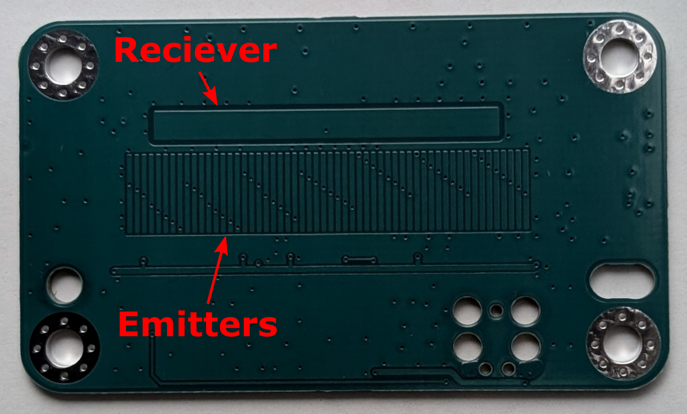 | 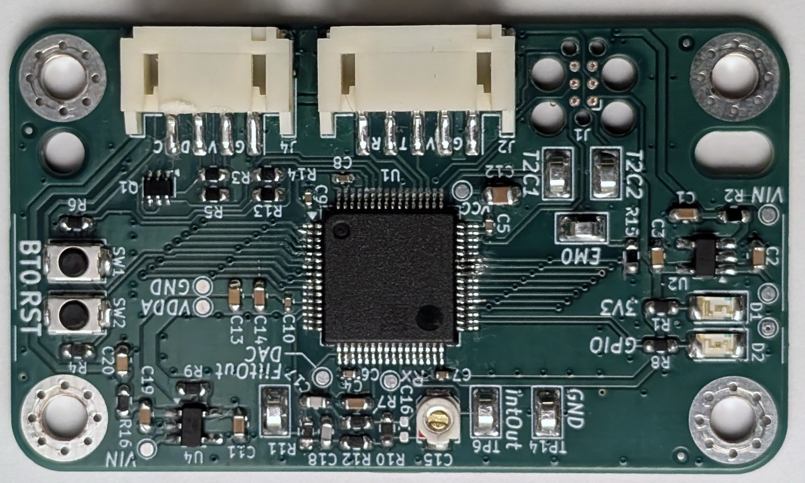 |

The sensor PCB has a sensing grid of 8 repeating transmit antennas, which I've called **emitters**. It also has an RX antenna, which feeds a charge integrator and an anti-alias filter. The analog hardware is fully integrated within the STM32L4. See [Analog Frontend](#analog-frontend) for more design information.

| Reflector PCB Top                                                             |
| ----------------------------------------------------------------------------- |
| 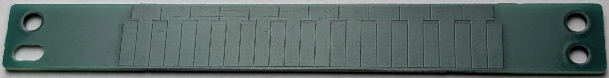 |

The reflector has a row of T-shaped copper pads. They "reflect" the capacitance of four of the eight repeating emitters into the RX antenna.

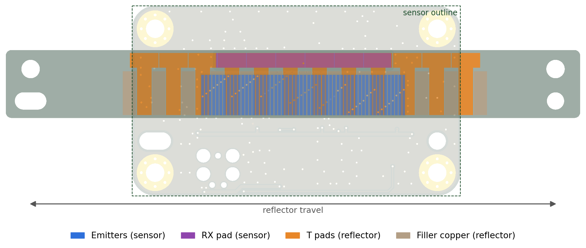

The position of the reflector relative to the sensor decides which emitters couple, and how strongly.

**Measurement cycle.** The STM32 steps its 8 emitter pins through a fixed 16-step pattern. At each step, some emitters switch low-to-high or high-to-low. Charge couples through the reflector into the RX antenna. A charge integrator captures it, a low-pass filter smooths it, and the ADC oversamples it. The steps run at 16kHz, so a full sequence completes at 1kHz.

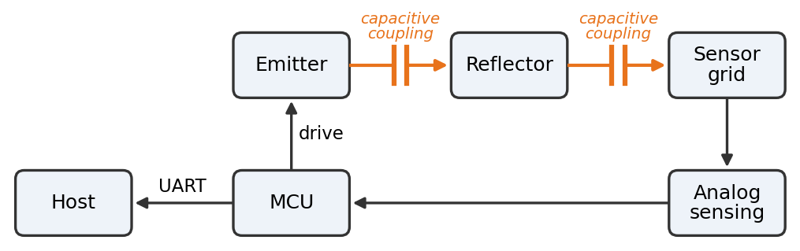

**Position estimate.** Each sequence gives a position within one period. The [Functional Description](#functional-description) explains how. Unwrapping successive estimates gives a continuous position. For this to work, the sensor can't be moving too fast for the algorithm to track. Conservatively, the maximum speed might be 0.6m/s, although I have not tested this.

**Output.** The sensor outputs a hex-equivilent floating point value over UART at 460800 baud, every millisecond. The script `tests/LiveView.py` plots a position on the host. The sensor can also output other formats and debugging information.

## Status and Limitations

A capacitive encoder is sensitive to liquids between the boards. At these accuracies, thermal expansion over long distances also matters. Plan for both if you would like to integrate with this.

When I started, I hoped for 10µm electrical accuracy. My first revision was about 0.5mm. I'm still working towards 10µm, along with a few other features:

- Automatic electrical calibration.
- Temperature compensation.
- Less reliance on the STM32L4, which is getting harder to source. The plan is a more standard STM32 with a discrete analog frontend.
- Improvements to the layout and mechanical design.
- Absolute position sensing.

I'd welcome help with these! Especially the mechanical design, which is far outside my expertise. See [CONTRIBUTING.md](CONTRIBUTING.md) for how to get involved.

# Practical Accuracy Measurements

I give an accuracy 'rating' of 40µm. I measured the error against a Mitutoyo 543-793B-12 digital indicator. The [mechanical README](mechanical/README.md) has more detail on the setup. I read the accuracy figure visually from the plots and rounded it up conservatively. My overall design isn't mature enough for a true tolerance stackup yet. The [tests README](tests/README.md#accuracy-analysis) has an in-depth analysis. Here is a summary of the major error sources:
- **Systematic error** is dominated by a periodic error that correlates with position. It's the large triangular deviations around 1–3mm and 7–9mm. There is also a smaller error that repeats every emitter (0.635mm) and drift that most likely comes from my test assembly.
- **Noise** is smaller than the systematic error. It is mostly white noise, plus a low-frequency resonance of my 3D printer.

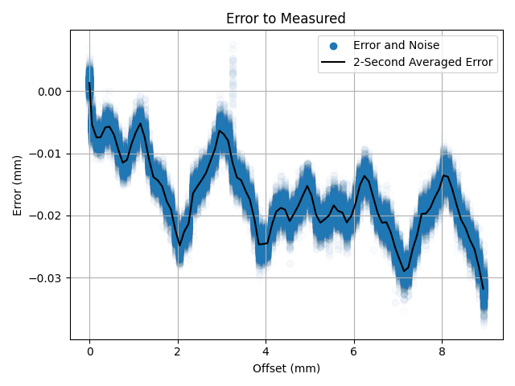

# Functional Description

## Measurement Cycle

The diagram below gives an overview of each step of a position measurement:

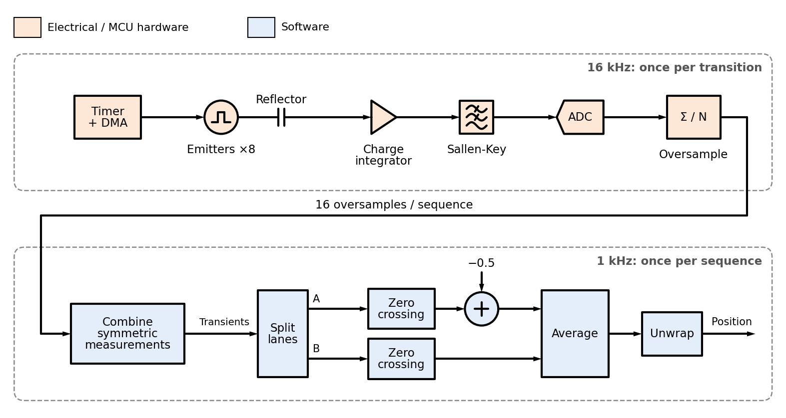

The emitters switch at 16kHz, stepping through 16 states. After all 16, the measurements go through the position algorithm. 

The timing diagram below shows an example of the 16 states:

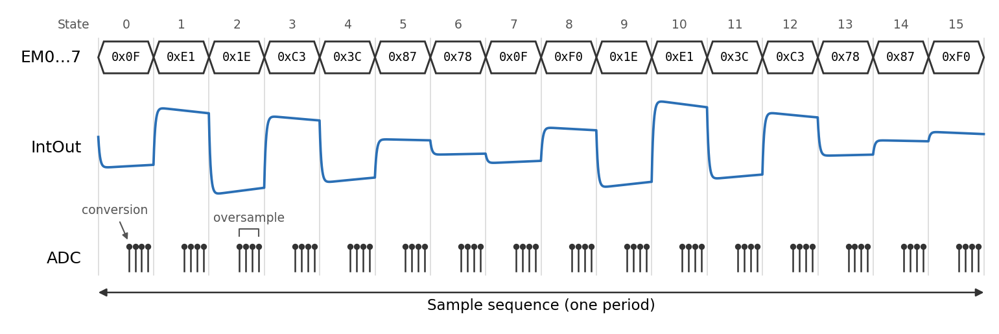

The integrator output always has roughly the shape shown in the plot. As the position changes, it appears phase-shifted relative to the zero position.

# The Position Algorithm

This section builds up the reasoning behind each step of the position algorithm. The final steps are best read in [the code](firmware/src/sensor-math.cpp).

The sensor measures how the reflector lines up with the emitters, which are coupled to the RX antenna through capacitance.

Consider a single emitter. If the reflector overlaps it, there is a strong capacitance from the emitter to the RX antenna. If not, there is no extra capacitance. When an overlapped emitter switches from low to high, the RX antenna sees a pulse.

When the emitter is only partly overlapped, the coupling falls roughly linearly with movement.

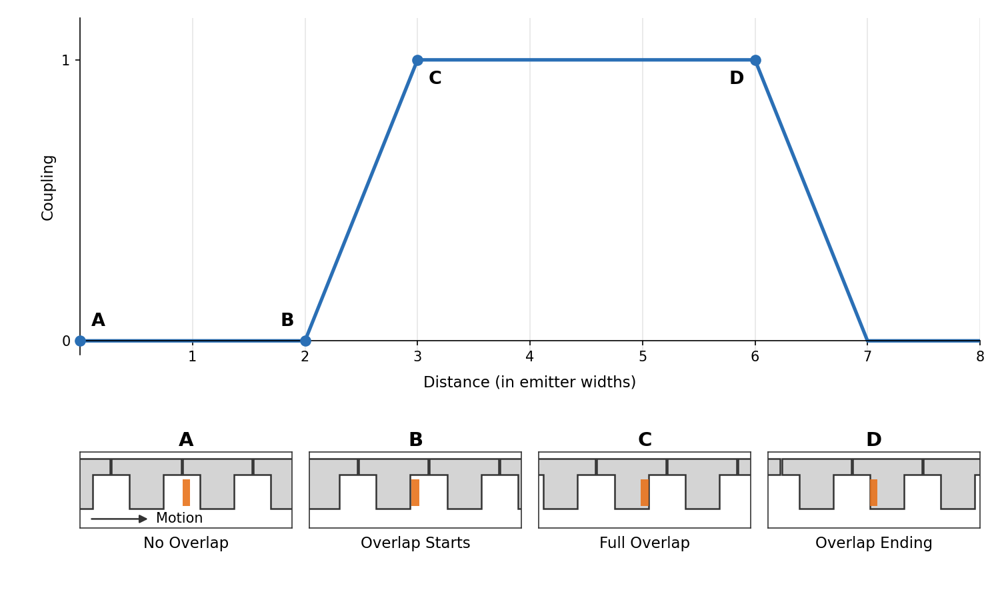

With more emitters, the effect adds up linearly. By driving the first four emitters low-to-high and the next four high-to-low, the size of the pulse tells us where the reflector is.

In the plot, "coupling" goes negative. That means the reflector is aligned with the emitters making the negative transition, not that the capacitance is negative.

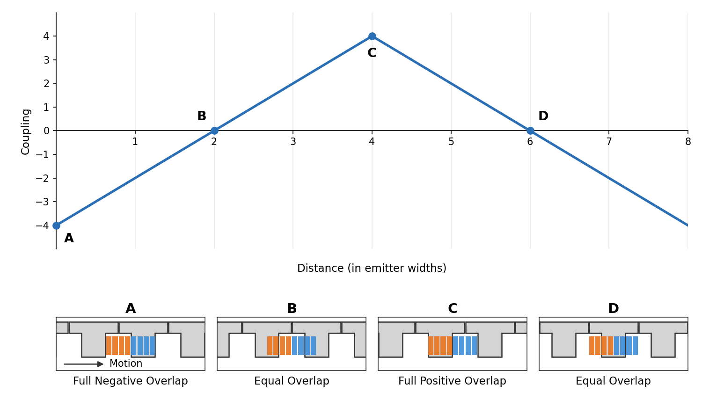

That is technically enough to get a position, but there are two problems:

1. We don't know the pulse size of a fully overlapped emitter, and it changes over time.
2. Because the pattern repeats, each pulse size matches two possible positions. In the plot below, a measurement could mean 3.1 or 4.9, and we can't tell which.

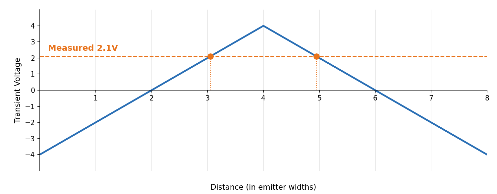

Taking more measurements solves both problems. Instead of sampling one location, we "slide" the pattern across all eight emitters, giving eight pulse sizes. The second four are the negatives of the first four, so they combine into four pulses.

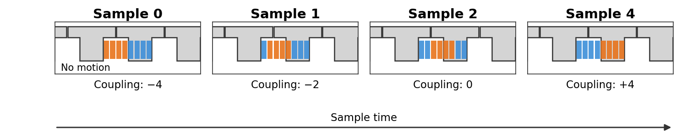

Each of the four pulses gives two candidate positions, and we could pick the one they all agree on. Near the edges, though, noise makes that choice unreliable. The resulting error is larger than the noise itself, and it is nonlinear.

Finding the zero crossing of the line through the pulses avoids the nonlinearity and gives lower noise. Depending on the convention, there may be a constant offset (-2 in the plot below).

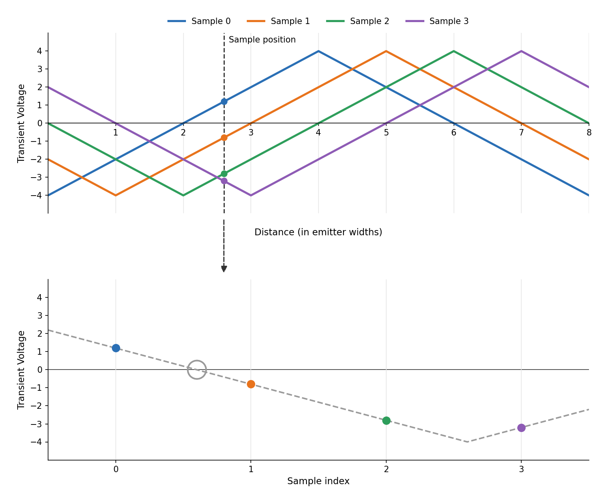

A few practical problems remain:

1. The samples don't always cross zero.
2. A digital line can't repeatedly step in the same direction.
3. The emitters and reflector pads need clearance between them.

## Pulse Sequences That Don't Cross Zero

The signal is periodic, so we can wrap the first pulse around after the last one and interpolate there. A virtual sample at location 4, equal to the negative of location 0, always creates a zero crossing if there wasn't one already.

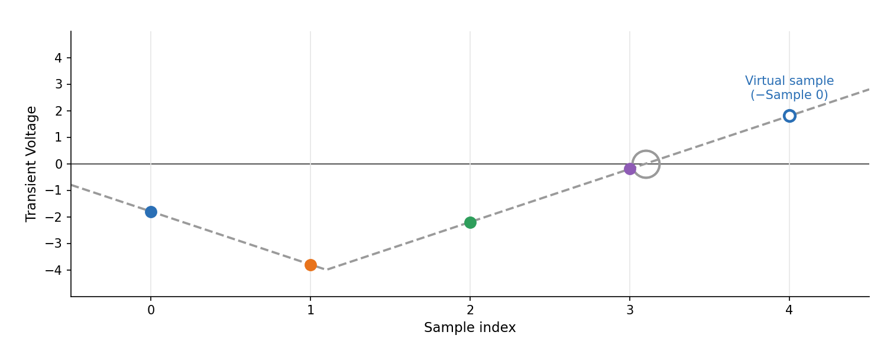

## Repeated Positive/Negative Pulses

True sliding pulses would need the emitter voltages to keep stepping up. A digital line can only go low-to-high once; it has to go high-to-low before it can rise again.

My solution is a partial transient between the full ones, which flips three emitters in each half. Why not flip just one? Because this extra transient can also give a position. Three emitters make a larger signal, and one that works with the same interpolation method.

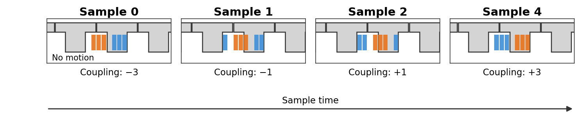

The three-emitter transients give a pulse sequence much like the four-emitter one. They only reach 3/4 of the magnitude, but within that range the signal looks the same, so the same zero-crossing method gives a position.

That estimate is shifted ahead by 0.5 emitters, so adding 0.5 brings it into line.

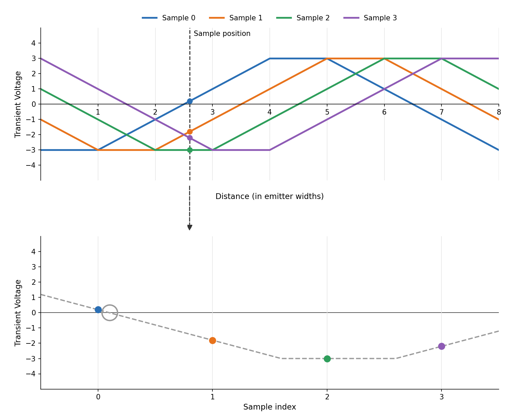

## Non-Zero Spacing

The emitters and reflector pads need electrical clearance between them.

A naive parallel-plate model would say the signal doesn't change while an edge passes over this gap, so positions inside it can't be recovered.

In reality, as long as the gap is small compared to the copper width, fringing at the copper edges adds significant capacitance. The transition is smooth, but unfortunately not a straight line.

Separating the sensor and reflector reduces the problem. I usually use about 0.1mm. The plot below shows the error that remains, despite fringing, when the PCBs touch.

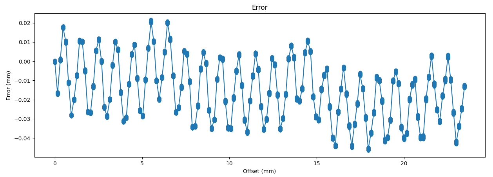

## Combined Symmetric Measurements

The design takes advantage of a few symmetries in the emitter pattern.

Of the 8 emitters, the second half is always driven as the inverse of the first half. The emitter states are states in time, but what we measure is the difference from one state to the next. The [firmware README](firmware/README.md#emitter-states-and-lanes) shows how this maps to the code.

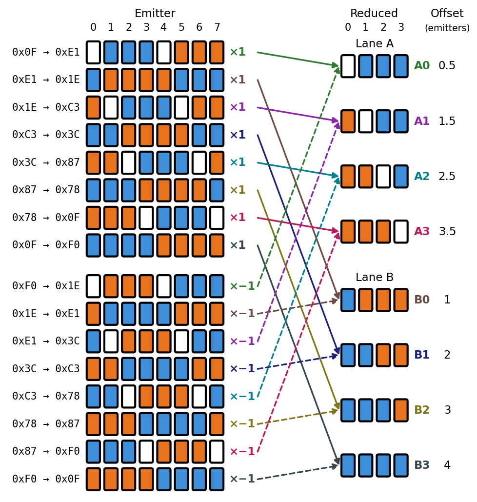

The second half of the sequence is also an inverted repeat of the first half. Each transient in the second half is the negative of its partner in the first half, so subtracting the two doubles the signal.

The transients also interleave. They alternate between flipping three emitters in each half and flipping four. I call these two interleaved sets **lanes**, which leaves two lanes of four values each. Most of my analysis only considers four emitters and four transients, because that describes most of the signal.

Each lane gives one zero-crossing estimate with its own offset. After applying the offsets, the estimates are averaged.

The offsets are relative. It doesn't matter which lane is treated as the reference, as long as the difference between them is consistent.

# Analog Frontend

The RX antenna receives a voltage pulse. Its height depends on the capacitive coupling, and how long it lasts depends on resistive leakage.

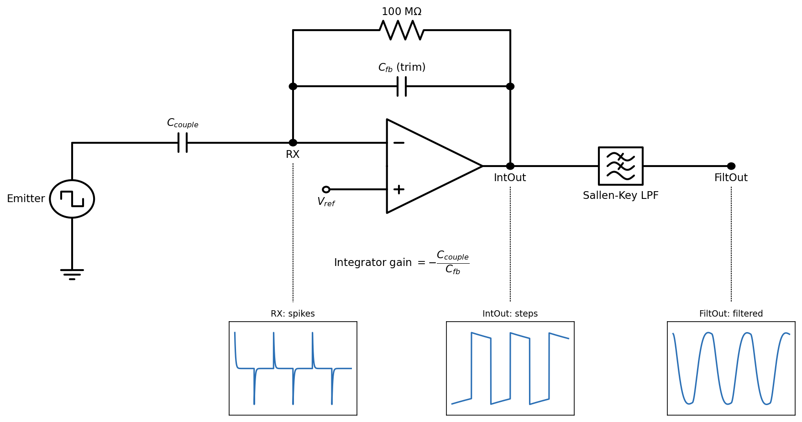

You can sample that pulse directly with the ADC, but only for low accuracy. It needs very short sample windows and can't be anti-alias filtered well, so it picks up a lot of noise.

Instead, the RX antenna feeds a **charge integrator**. The ratio of its two capacitors sets its gain. The integrator turns the short pulse into a held step. The ADC can then oversample over a long window, which improves SNR.

An **anti-alias filter** follows the integrator. It removes the above-Nyquist electrical noise that the integrator passes through.

The firmware measures the change from one integrator state to the next, so the integrator never needs a reset.

The [hardware README](hardware/README.md#sensor-analog-frontend-design-details) covers the design in more detail with rationale.

# Mechanical Integration

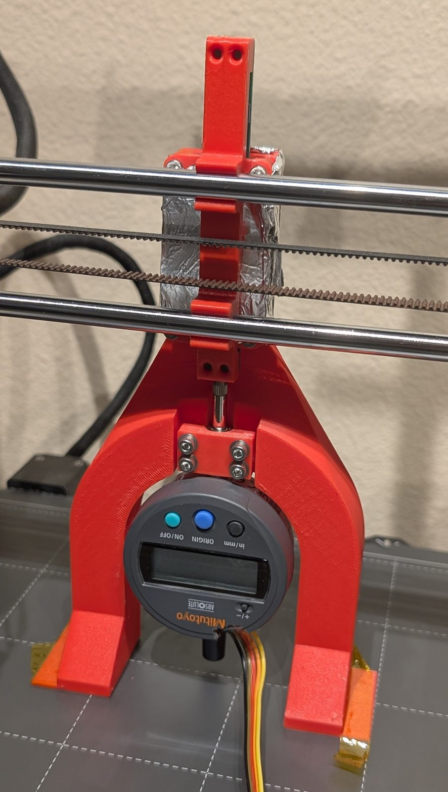

The sensor and reflector PCBs are both aligned with 3mm pins and mounted with M3 fasteners.

The sensor and reflector need a gap between them. I aim for 0.1mm. Without it, the signal is larger, but [physical nonlinearities](#non-zero-spacing) wipe out any SNR benefit.

I haven't measured how sensitive the sensor is to a gap, sideways offset or tilt. The effect doesn't seem large, and in theory the design should tolerate all three reasonably well.

I tried a 3D printed shim to set the gap, but two layers of Kapton tape turned out to be much easier and more accurate.

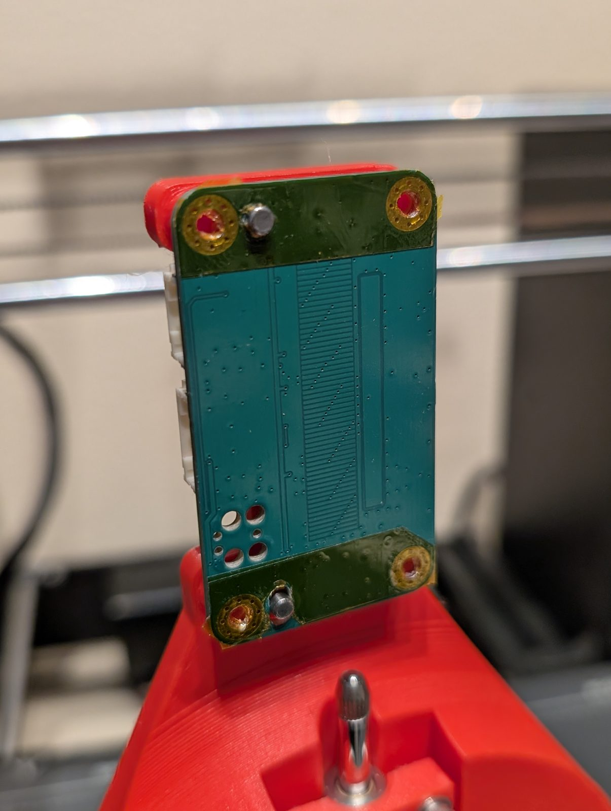

The [mechanical README](mechanical/README.md) covers a typical mechanical stackup and the test fixtures.

# License

This project uses two licenses:

| Folders                        | License                              |
| ------------------------------ | ------------------------------------ |
| `hardware/`, `mechanical/`     | [CERN-OHL-P-2.0](LICENSE-CERN-OHL-P) |
| `firmware/`, `tests/`, `docs/` | [MIT](LICENSE-MIT)                   |

Both are permissive. You can use, modify, make and sell the designs and code, including commercially, as long as you keep the copyright and license notices.

Some files are covered by their own licenses instead:

- `firmware/src/cube-mx-autogen/` contains files generated by STM32CubeMX, © STMicroelectronics. They are under BSD-3-Clause or Apache-2.0, depending on the file. See the [license file in that folder](firmware/src/cube-mx-autogen/LICENSE.md).

See [LICENSE](LICENSE) for the summary.
