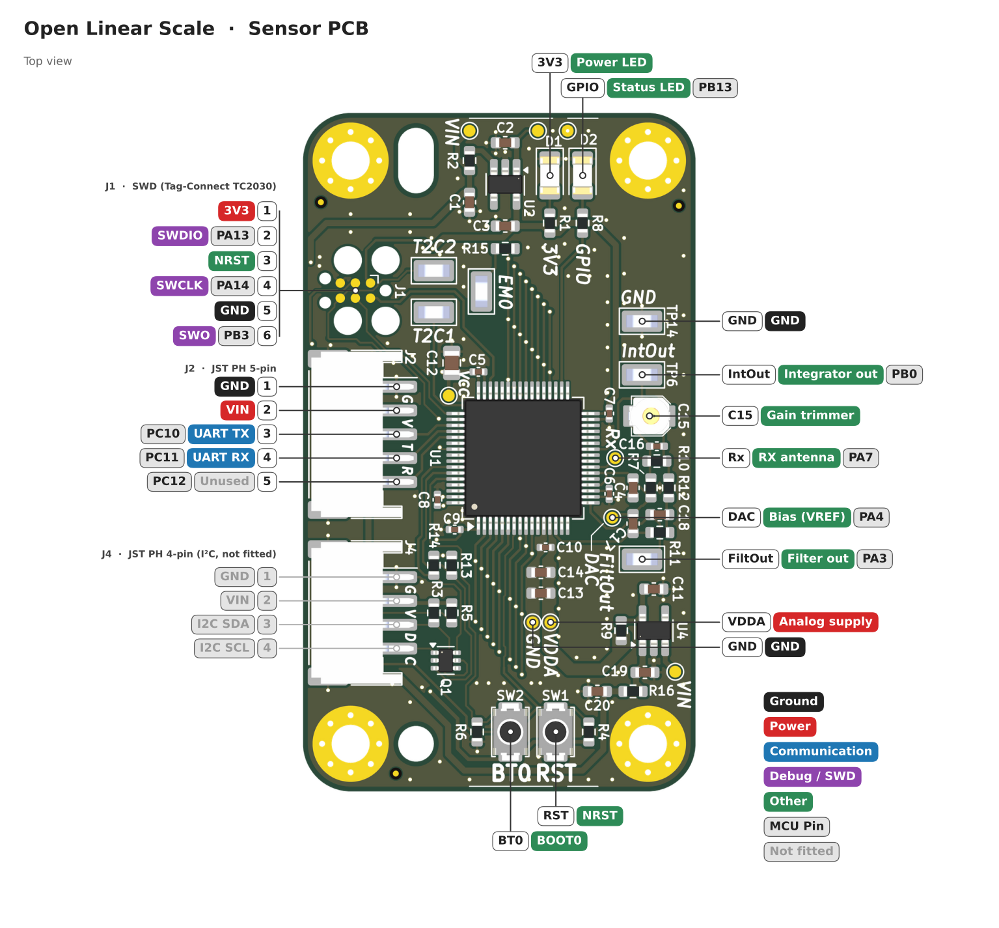

# Hardware

All boards are KiCad 9 projects. Their outputs (fabrication, assembly, BOM and STEP files) are generated by each project's `exports.kicad_jobset` and are not committed to the repository. The [Hardware workflow](../.github/workflows/hardware.yml) builds them on GitHub and publishes them as release files.

The links below point to the [development release](https://github.com/nichlock/open-linear-scale/releases/tag/development). It is rebuilt from the latest commit on `main`, so it is only the latest state of the design. It has not been checked as a whole or built as hardware. Versioned releases will be listed on the [releases page](https://github.com/nichlock/open-linear-scale/releases).

## Sensor PCB

This is the active board which runs the firmware. 

The bill of materials does not include a programming connector. 

There is not a programming connector footprint on the board. Instead there are pads for a Tag-Connect bed-of-nails style connector. I used the TC2030-CTX with my JLink EDU mini. More details on flashing are in the [firmware readme](../firmware/README.md#building-and-flashing).

You will also need a UART adapter. For debugging, I use this [DTECH USB to TTL Adapter](https://www.amazon.com/dp/B0DSS4Y8R5) part off amazon as the debug UART adapter and 5V power supply.

The power input accepts 5V. It goes directly to two AP7354 LDOs and nowhere else. I have not done formal WCA or testing, but an input of 4.5~5.5V should pose no issues. The sensor draws peaks of about 25mA.

- [PDF Schematic](sensor-pcb/sensor-pcb.pdf) (committed with the design)
- [Fabrication Files](https://github.com/nichlock/open-linear-scale/releases/download/development/sensor-pcb-fabrication.zip) (development release)
- [Assembly Files](https://github.com/nichlock/open-linear-scale/releases/download/development/sensor-pcb-assembly.zip) (development release)
- [Bill of Materials](https://github.com/nichlock/open-linear-scale/releases/download/development/sensor-pcb.csv) (development release)
- [STEP Model](https://github.com/nichlock/open-linear-scale/releases/download/development/sensor-pcb.step) (development release)

| Parameter      | Value           |
| -------------- | --------------- |
| Layer count    | 4               |
| Thickness      | 1.6mm           |
| Surface Finish | HASL acceptable |

| Layer      | Purpose                                                         |
| ---------- | --------------------------------------------------------------- |
| Top        | Signals and components                                          |
| Internal 1 | GND (shield from top)                                           |
| Internal 2 | GND (with an opening to reduce capacitance to the receiver pad) |
| Bottom     | Sensor Grid                                                     |

An I2C STEMMA-style header was designed in but DNP'd from the BOM. At time of writing I have not tested I2C at all.

J2 (a 5-pin JST PH) is the only connector that is needed for typical operation. Connect a 5V supply and a UART device. Right now, PC12 isn't used. It might be used later as a part of an SSI output.

> Side note: do you actually need four layers? I tested this. I first designed this board to work with two layers, then at the end I added two more internal ground planes. I ordered a 2- and 4- layer variant. There is some extra inaccuracy caused by asymmetric coupling from the emitters to the RX pad. It results in a higher inaccuracy on the order of 0.1mm. The 4-layer board has ground planes which fix this. In theory electrical calibration could fix this too, but I haven't gotten to calibration at time of writing.

## Reflector PCB

This PCB is fully passive and has no components. It only serves to provide the "T" pattern as detailed in the main README. There is no schematic or BOM.

This was named the "small" variant. A larger variant was designed first but has never been tested. I chose to keep only one length at time of initial release. See [Making a Longer Reflector](#making-a-longer-reflector) if you're interested in a longer version.

This PCB is a two layer stackup. Copper is placed on the "wrong" side of the board (the side that faces away from the sensor PCB). That copper was added to mitigate warping. *(When I built up an old revision of this encoder, I ordered the reflectors with a 0.8mm fab, and it was very warped.)*

- [Fabrication Files](https://github.com/nichlock/open-linear-scale/releases/download/development/reflector-pcb-sm-fabrication.zip) (development release)
- [STEP Model](https://github.com/nichlock/open-linear-scale/releases/download/development/reflector-pcb-sm.step) (development release)

| Parameter      | Value                        |
| -------------- | ---------------------------- |
| Layer count    | 2                            |
| Thickness      | 1.6mm                        |
| Surface Finish | Not applicable (no openings) |

# Making a Longer Reflector

The reflector PCB is a repetition of two pads every 200mil.

You can make a longer reflector by simply copy/pasting however many of these that you need in a row on a 200mil grid.

After that, move the mechanical mounting features.

Note that the usable travel is `((number of repetitions) * 0.2") - (1.2")` (excluding mechanical mounting space). The 1.2" is the width of the sensor grid. That grid needs to be fully covered for the sensor to work reliably.

# Sensor Analog Frontend Design Details

We receive a voltage pulse on the receiving antenna. The height of the pulse depends on the capacitive coupling, and the length of time that the pulse lasts depends on the resistive leakage.

## ADC-Only Samples

One way to measure the RX input is to put it directly into an ADC. At first, this was all I did.

This method works well enough for low-accuracy. There are two problems:
1. The ADC needs to use very small sample windows, making it vulnerable to noise.
2. The signal can't be conditioned easily. The shape of the pulse is also not conducive to anti-alias filtering. As a consequence, I was getting massive problems with above-Nyquist electrical noise while testing near my 3D printer.

## Charge Integrator

A major improvement to this design was the charge integrator. This allows us to widen the ADC window all the way to a zeroth order hold.

The charge integrator creates a gain that is the ratio of the two capacitors. I used a trimmer capacitor for adjustable gain.

Another major benefit is that we can now oversample the ADC over a long window of time. That alone gives a better SNR.

Although this did improve the SNR against white noise, it doesn't solve the entire anti-aliasing problem. Most noise still goes right through the charge integrator. My 3D printer's major noise component comes in 23kHz, compared to the 16kHz step rate (this was before I added any shielding). So an anti-alias filter is added on. The filter slews the signal significantly, but it results in a much better SNR in the presence of above-Nyquist electrical noise.

The integrator is leaky (100MΩ resistor) in order to prevent DC drifting.

The firmware measures the difference between one integrator state and the next, not the magnitude of one pulse against vref. That means we don't have to worry about resetting the integrator.

## VREF

Vref is chosen at 50% VDDA, or 1.65V. It's generated by a DAC. There could be benefits to tuning VREF live since there seems to be asymmetry in the I/O leakage, pulling the average DC value on the RX node away from 50% VCC. That would give more budget for a higher input gain. This isn't a major contributor to accuracy issues so I don't do it right now.

## Trimmer

The easiest way to set the trimmer is to twist it while monitoring the integrator output on an oscilloscope. I also do it by using the LiveView test script, but that can be a little cumbersome due to delays in the plotting.

The trimmer I specified only goes down to 4.5pF. It gained the capacitive pulse up to 1Vpp. I would like a higher magnitude to help reduce the impact of the white noise at the ADC input, although that is scope for future work.

