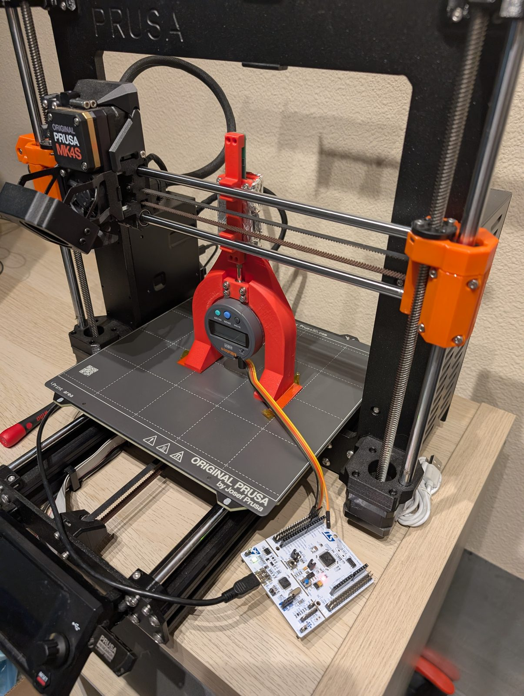
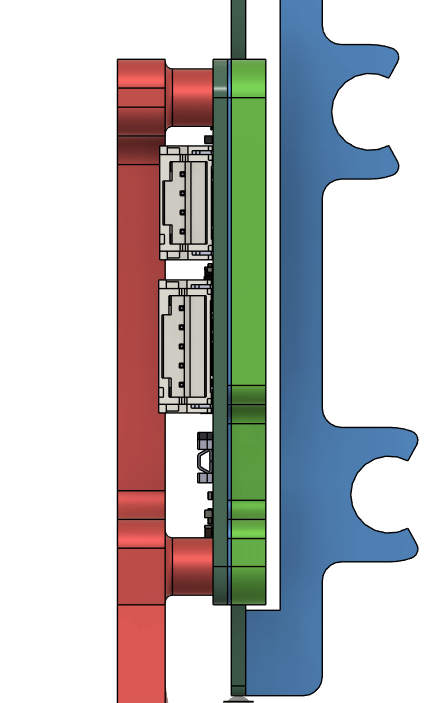
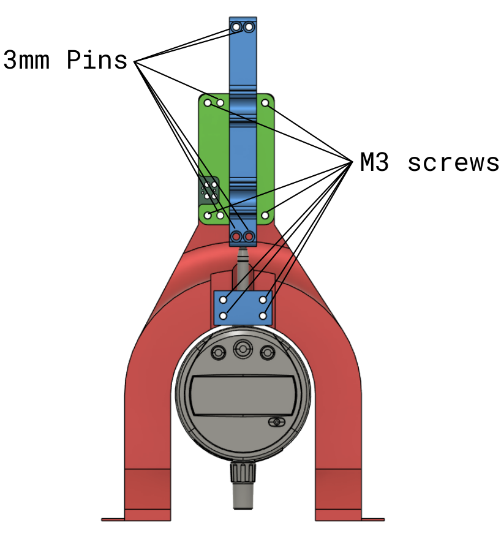

# Mechanical

  

This folder holds designs for the mechanical test fixturing. Currently, it only contains one calibration fixture.

# Mechanical Stackup

A typical mechanical stackup is shown below. If you're developing mechanical installations, you will also want to see the [integration drawing](pcb-alignment-drawing.pdf).

| Color      | Purpose                                                                         |
| ---------- | ------------------------------------------------------------------------------- |
| Red        | Frame.                                                                          |
| (Multiple) | Sensor PCB.                                                                     |
| Cyan       | Shim between PCB bottom and slider housing (Kapton tape).                       |
| (Multiple) | Reflector PCB.                                                                  |
| Green      | Slider housing, which restrains the sensor PCB.                                 |
| Blue       | Reflector mount (takes the place of mounting the reflector to a rigid machine). |

# Setting the Gap

I targeted a gap of 0.1mm. I have not measured how critical the gap is.

I create the gap using two layers of Kapton stacked on top of each other, on either side of the sensor grid. The Kapton should be long enough that it also spaces out the slider housing's mounting bosses.

# Test Fixtures

## `calibration-prusa`

| Real Assembly                                                                                                           | Pin/Screw Locations                                                                                                                          |
| ----------------------------------------------------------------------------------------------------------------------- | -------------------------------------------------------------------------------------------------------------------------------------------- |
|  |  |

### Files

| File                     | Contents                                                          |
| ------------------------ | ----------------------------------------------------------------- |
| `Frame.stl`              | Frame that holds the sensor PCB and indicator.                    |
| `Indicator-Clamp.stl`    | Clamp for the digital indicator.                                  |
| `Slider-Housing.stl`     | Housing that restrains the sensor PCB.                            |
| `Reflector-Mount.stl`    | Mount that holds the reflector PCB on the printer's X-axis rails. |
| `calibration-prusa.step` | The full assembly, for viewing in any CAD tool.                   |
| `calibration-prusa.f3z`  | The Fusion360 archive export of the full assembly.                |
| `assembly-photos/`       | Photos for each assembly step below.                              |

### BOM and Assembly Instructions

This is a rough BOM in an attempt to capture the somewhat patched-together design I created.

| Part                                          | QTY | Step |
| --------------------------------------------- | --- | ---- |
| Frame                                         | 1   | 1    |
| 3mmx10mm pin                                  | 6   | 1, 6 |
| Dial/Digital Indicator (Mitutoyo 543-793B-12) | 1   | 1    |
| Indicator Clamp                               | 1   | 1    |
| M3x16mm screw                                 | 4   | 1    |
| M3 washers                                    | 8   | 1, 3 |
| Sensor PCB                                    | 1   | 2    |
| Kapton Tape for Shimming                      | 1   | 2    |
| Slider Housing                                | 1   | 3    |
| M3x12mm screw                                 | 4   | 3    |
| Aluminum Foil                                 | 1   | 3    |
| Double-sided tape                             | 1   | 3    |
| Reflector PCB                                 | 1   | 4    |
| Ground wire for shielding                     | 1   | 4    |
| Reflector Mount                               | 1   | 6    |
| Tape for printer bed                          | 1   | 10   |
| SPC cable or wires                            | 1   | 11   |
| STM32 Nucleo (NUCLEO-F446RE)                  | 1   | 11   |

These assembly instructions align with the photos in `assembly-photos`.

Before starting, wire up your sensor. You can always buy the SPC connector; I chose to save $100 and wire it myself. You should find the wiring for your sensor in your user manual since they can differ. See [`mitutoyo-wiring.jpg`](calibration-prusa/assembly-photos/mitutoyo-wiring.jpg).

1. Press-fit the pins into the frame. Install the indicator using the Indicator Clamp, 16mm screws, and four washers. ([photo 1](calibration-prusa/assembly-photos/1-cal-prusa-unassembled.jpg))
2. Place the Tape for Shimming on the Sensor PCB and cut out the holes. Place the sensor PCB on to the Frame by inserting into the pins. It should fit snugly. ([photo 2](calibration-prusa/assembly-photos/2-cal-prusa-pcb-with-kapton.jpg))
3. Install the Slider housing using the rest of the washers and the 12mm screws. Place double-sided tape where the end of the aluminum foil will go (left side in the picture) and cut and install the foil. ([photo 3](calibration-prusa/assembly-photos/3-cal-prusa-with-housing.jpg))
4. Ground the aluminum foil. For this particular design revision and assembly, you'll just have to wire the shield directly to any PCB ground. ([photo 4](calibration-prusa/assembly-photos/4-cal-prusa-with-housing-shield-closeup.jpg))
5. Insert the Reflector PCB. The top of the T aligns with the sensor PCB's receiving pad. ([photo 5a](calibration-prusa/assembly-photos/5a-cal-prusa-with-reflector.jpg), [photo 5b](calibration-prusa/assembly-photos/5b-cal-prusa-reflector-far-away.jpg))
6. No photo; press the four remaining pins into the Reflector Mount.
7. Home the 3D printer. Then, snap the reflector mount on to the 3D printer's x-rails. Set the Z-height so that the reflector-mount pins are close to (but slightly below) perfect alignment with the reflector PCB. ([photo 7](calibration-prusa/assembly-photos/7-cal-prusa-reflector-mount-alignment.jpg))
8. Push the reflector PCB slightly down and push the assemblies together. ([photo 8](calibration-prusa/assembly-photos/8-cal-prusa-reflector-mount-installed.jpg))
9. Make sure the bottom is mated well. ([photo 9](calibration-prusa/assembly-photos/9-cal-prusa-reflector-pins-bottom.jpg))
10. Tape the assembly to the 3D printer build plate. This tape does not need to be perfect since it doesn't directly affect accuracy. It exists to prevent slipping out. ([photo 10](calibration-prusa/assembly-photos/10-cal-prusa-assembled.jpg))
11. Get the Nucleo ready (or wire up using the manufacturer's data cable). ([photo 12](calibration-prusa/assembly-photos/12-cal-prusa-nucleo.jpg))
12. Wire up the Nucleo. See the [SPC firmware README](../tests/spc-firmware/README.md) for the wiring.

The finished assembly is shown in [photo 11](calibration-prusa/assembly-photos/11-cal-prusa-assembled-with-nucleo.jpg).

### Design Details

The "calibration" fixture is currently the only one I trust enough to publish. It's designed to sit on the build plate of a Prusa MK4S 3D printer, which acts as a motorized linear stage for sampling lots of positions.

A Mitutoyo indicator is mounted to this to run the [accuracy/calibration tests](../tests/README.md#accuracy-analysis).

The reflector mount is designed to only take pins. The reflector is never screwed in, even though there are holes meant for screws. The pins are sufficient to hold it well enough in my testing. Pin-only makes the assembly much easier to install and remove from the printer. 

The reflector mount snaps into place on the Prusa MK4S X-axis rails.

I added shielding in the form of aluminum foil. Eventually, my test fixturing would be metal. For now I just wire a ground wire to the aluminum foil. You could also shield to the screws IF they make electrical contact to the screw holes. Due to the alignment pins, they often do not make contact. Again that would be fixed with metal fixturing.

Since this is a 3D print and it's mounted on a 3D printer, there are challenges with the accuracy. Mostly, these are dealt with by having the Mitutoyo mounted to the same fixture as the sensor. But there is also some flexing of the 3D printed frame.

I'm not a mechanical engineer, and the mechanical design is far from perfect. I'm working on a standalone calibration fixture, and I'd welcome help from anyone with mechanical design experience, whether that's improving these parts, designing a machined version, or mounting the sensor on a real machine. Open an issue if you'd like to get involved!

# Printing

I printed everything in PLA, 0.2mm. I didn't tweak the settings much for rigidity because the current version is good enough that I want to move forwards using machined parts instead.
