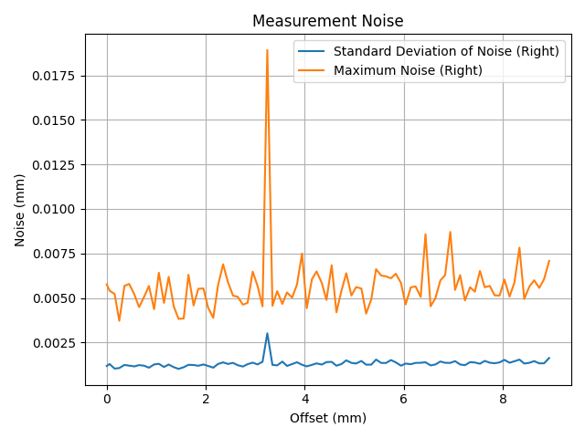
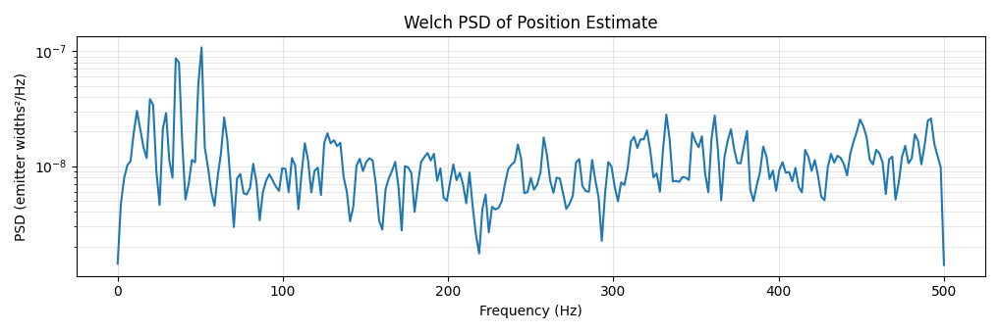
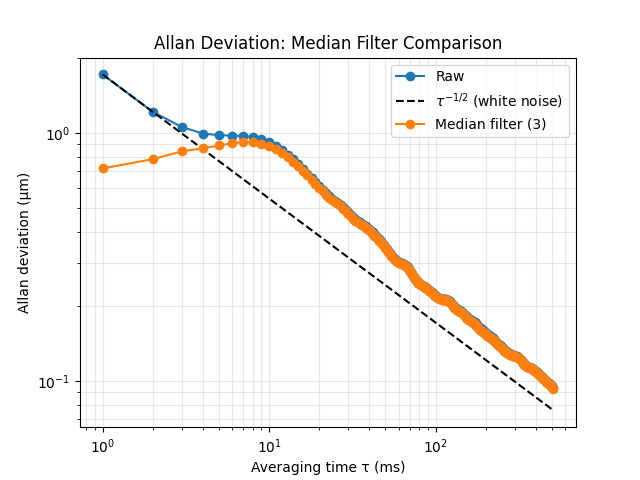

# Tests

This code is mostly quick and dirty test scripting.

There are three focuses in my scripts:
1. Quick Live Data
   1. `LiveView.py` will plot transients and position data fully live. Useful for eyeballing things.
   2. `LiveSingleBurst.py` will read transients for one full burst and plot analysis of those transients. Useful for more formal analysis. It doesn't save the data.
2. Stored Burst Data
   1. `BurstReader.py` saves the data from one full burst to an output file then exits.
   2. `BurstAnalysis.py` will read back and help analyze one single burst of data.
3. Calibration Data
   1. `AccuracySamplerAuto.py` will move a Prusa 3D printer and then read back one full burst of the sensor. This helps to understand the accuracy of the sensor, although it relies a lot on the 3D printer, which is not very accurate at this scale.
   2. `AccuracySamplerCalibration.py` is the evolution of the above. It will move the 3D printer then read back one sensor burst and a Mitutoyo device. This works in conjunction with a NUCLEO-F446RE running the [`spc-firmware`](spc-firmware/README.md).
   3. `AccuracyAnalysis.py` is the script to analyze the many bursts captured in a calibration sweep.

My work on this project so far has not been focused on creating formal host software, so these scripts are provided as-is. 

I usually turn to these because I have new questions to answer, so my use of these scripts involves regularly modifying them.

## Ports and Settings

Each script takes its serial ports and baud rates as command-line arguments. Run a script with `--help` to see them. The defaults are my own setup (sensor on `COM4` at 460800 baud), so you will usually need to pass your own port, for example:

```sh
python LiveView.py COM3
python LiveView.py /dev/ttyUSB0
```

Other settings, such as file paths and test parameters, are constants at the top of each file.

## Burst Mode

The firmware starts in text position mode. These scripts read bursts and need the sensor in a burst output mode first:

- `LiveSingleBurst.py`
- `BurstReader.py`
- `AccuracySamplerAuto.py`
- `AccuracySamplerCalibration.py`

The scripts don't change the mode themselves, and they print a warning about this when they start. If one stops with a UART timeout, set the mode manually with a serial terminal:

```
w 2 1      # SENSOR_STATE = stop
w 6 3      # SENSOR_OUTPUT = OUTPUT_DBG_BURST_DIFF (lane transients)
w 2 0      # SENSOR_STATE = start
```

The mode is not saved, so do this again after every reset. See [Output Format](../firmware/README.md#output-format) in the firmware README for all of the modes.

`LiveView.py` reads the hex position output (`w 6 1`) and the lane transient bursts. It does not parse the default text position output.

## Data Files

Measurement data is not included in this repository, at least for now. The scripts save their data here:

- `BurstReader.py` saves each burst to `impulse_data/` by default.
- The accuracy samplers ask for an output folder when they start.
- `AccuracyAnalysis.py` reads a sweep from `./data/accuracy` and `./data/accuracy_mitutoyo` (the `DIRECTORY` and `MITUTOYO_DIRECTORY` constants).

`tests/data` and any `accuracy` folder are in `.gitignore`, so data saved there isn't committed by accident. `impulse_data/` is not ignored. To run the analysis, capture your own sweep first and point those constants at it.

# Accuracy Analysis

I measured the error with a Mitutoyo 543-793B-12 digital indicator. The test fixtures are described in the [mechanical README](../mechanical/README.md).

I moved the sensor by a total of 9mm in steps of 0.1mm using my 3D printer. The stepsize was not perfect, but it's not a part of the analysis because the indicator tells me a true position of my sensor. I then processed the measurements using a median filter (see the [noise](#noise) section for more information).


There are two parts to the error. The noise, which is shown in blue, and the systematic error, in black. I consider these in detail in the next sections.

## Systematic Error

The systematic error measurement has a very long 2-second averaging window, so I treat it as though it were noise-free.

There are a few sources here:
- The largest source is a periodic error that seems to correlate to the position. These are the two large triangular deviations around 1~3 and 7~9mm. It might be possible to calibrate this out, but I haven't tried that yet.
- Another source of error is a smaller triangular-looking error per each emitter. This is periodic over one emitter of 0.635mm.
- Finally, a major source of error here is the general drift. From 0~2mm, I think there is a drift of about 20µm. It's hard to say how large this is, but since it's not periodic, it's probably caused by my 3D printed assembly, with little in the way of proper constraints, bending out of shape.

## Noise

The noise is smaller than the systematic error. I plotted the standard deviation and peak observed error.



Below is a PSD of the noise frequencies.



The noise also has a few sources.

- Most of the noise is white noise. This can be seen in FFTs of the measurements.
- There is one clear frequency where noise is persistent at around 10~14Hz and the next 3 harmonics (on the PSD these are the peaks at the beginning). Sometimes the frequency varies depending on my setup. This low-frequency "noise" is being caused by real physical resonance of my 3D printer's relative z-height by a few µm. I'm working on a better mechanical setup that should help with this. For conservatism, I don't erase it from my analysis here.
- There is a big spike in the middle of the graph. In short this is caused by asymmetric emitter "strengths". When the algorithm jumps from linearly interpolating using one emitter over another, there is a small change in the output because those emitters don't necessarily predict an identical value. This particular position consistently jumped between two emitters. I believe this can be helped through calibration, but I haven't looked into that yet.

All of these can be helped by averaging and filtering. I only present data here after performing a 3-step median filter. An example of completely unfiltered noise is in [this picture](../docs/4-layer-sensor-noise-raw.png). I'm keeping the median filter for my analysis because I do think it makes physical sense to keep it long-term.

A final note is on the effect of averaging on this noise. Below is an Allan Deviation.



## Error Disposition

I chose to report a rough conservative number for the accuracy. I got the number visually from the plots. I did that because there is too much uncertainty in my mechanical setup and algorithms for me to feel comfortable listing exact numbers on what I measured.
